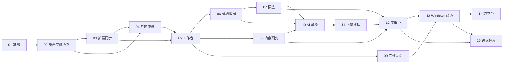

# 父子任务与依赖

2026-10-10 用户批准仅调整 01→02 启动门槛：01 自动检查通过，原生验收保留 UNVERIFIED，Windows 交付前补齐。其他依赖门槛不变。

父任务：[Markbridge 工作台](prd.md)。当前规划已获实施批准，子任务状态以各自 task.json 为准。编号是计划顺序，依赖验收仍需逐项核对。

| 编号 | 子任务 | 里程碑 | 前置 | 需求 |
|---|---|---|---|---|
| 01 | [工程基础与可运行桌面骨架](../10-10-mb-01-foundation/prd.md) | M1 | bootstrap 完成 | R01 |
| 02 | [Profile 身份、存储与共享协议](../10-10-mb-02-identity-storage-protocol/prd.md) | M1 | 01 | R02,R03 |
| 03 | [Chrome 扩展配对与实时同步](../10-10-mb-03-chrome-bridge/prd.md) | M1 | 02 | R02,R03 |
| 04 | [只读文件镜像与离线恢复](../10-10-mb-04-readonly-mirror/prd.md) | M1 | 02、03 | R03 |
| 05 | [书签工作台、搜索与多 Profile](../10-10-mb-05-library-workspace/prd.md) | M1 | 03、04 | R04 |
| 06 | [书签编辑、快照与条件撤销](../10-10-mb-06-safe-editing/prd.md) | M2 | 05 | R05,R11 |
| 07 | [本地标签与可选标题编码](../10-10-mb-07-local-tags/prd.md) | M2 | 06 | R06 |
| 08 | [网页抽取、摘要预览与缩略图](../10-10-mb-08-content-preview/prd.md) | M2 | 05 | R07,R12 |
| 09 | [应用内完整网页预览与隔离](../10-10-mb-09-webpage-preview/prd.md) | M2 | 05 | R08,R12 |
| 10 | [AI 单条建议、端点与隐私控制](../10-10-mb-10-ai-assistance/prd.md) | M3 | 06、07、08 | R09,R12 |
| 11 | [批量重分类、审查与恢复](../10-10-mb-11-batch-organization/prd.md) | M3 | 10 | R10,R11 |
| 12 | [死链、重复项与摘要检索](../10-10-mb-12-library-maintenance/prd.md) | M4 | 07、08、11 | R13 |
| 13 | [Windows 集成验收与本地安装包](../10-10-mb-13-windows-acceptance/prd.md) | M4 | 09、12 | R01,R14 |
| 14 | [macOS 与 Linux 原生适配](../10-10-mb-14-cross-platform/prd.md) | M5 | 13 | R15 |
| 15 | [可选本地向量检索](../10-10-mb-15-semantic-search/prd.md) | M5 | 12、13 | R16 |

## 依赖图

## 集成责任

02 拥有共享身份、schema 和 DTO；03/04 不自行重新定义身份。06 拥有所有浏览器写入、回执与撤销引擎；07/10/11/12 调用该引擎。08 拥有受限 fetch，12 的死链检测复用同一边界。09 独立拥有原生远程网页权限与会话隔离。13 负责跨任务集成证据，不能用集成任务推迟其他任务自己的必要检查。

父任务负责 R01–R16 需求覆盖、公共协议的一致性和最终集成结论。不得对父任务运行 start 来绕过子任务的实现门槛。

14 与 15 是明确的后续工作。Windows 首版不依赖这两个任务；父任务整体完成仍须处理这两个任务的范围和验收。
